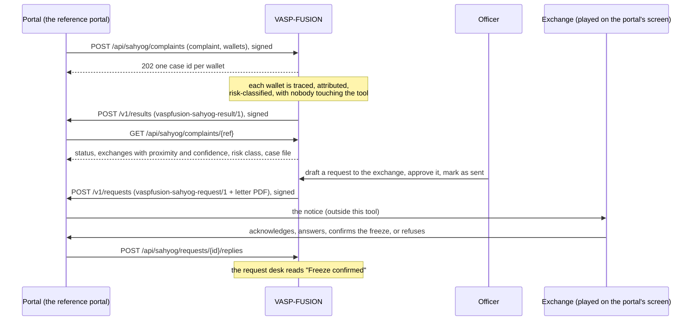

# SAHYOG contract: both directions

**What this is, and what it is not.** SAHYOG is the I4C portal through which complaints and notices move between law enforcement and intermediaries. **Its real interface is not public**: notices are issued through it by nodal officers of authorised agencies, and service providers are connected by arrangement with I4C. VASP-FUSION has never called it, and nothing in this repository is a description of SAHYOG's API. This document is **our side of a contract**: the routes VASP-FUSION offers, the calls it makes, the JSON on each, and how every call is signed. It is a proposal for I4C to map onto the real portal.

**What exists today.** Two separate programs that keep the two halves of this contract and exchange signed HTTP calls:

- **The tool** (`vaspfusion/`). Its intake and reply routes (sections 2, 3 and 6), and `HttpSahyogGateway`, which makes the outgoing calls of section 5 to whatever address `SAHYOG_URL` names.
- **The reference portal** (`refportal/`, `python -m refportal`, port 8100). A small program with its own process, port, store (SQLite) and signing code, written from this document and sharing no code with the tool. It plays the portal: an officer files a complaint on its screen, it posts the complaint to the tool, receives results and requests, and sends back the exchange's replies. **It is a simulator for demonstration, not the SAHYOG portal**; its screen carries that banner and uses no emblem, logo or styling of the real portal.

A conformance suite (`make conformance`, `tests/conformance/`) runs the contract between the two over real sockets and can be pointed at any other portal implementation. With no `SAHYOG_URL` set, the default, `MockSahyogGateway` writes everything that would cross into a folder (`data/sahyog_outbox/`) and **nothing leaves the machine**; the tool's own `/sahyog-sim` screen then plays the portal inside the same program.

**What is missing to connect to the real portal** is not code on our side. It is the page at the end of this document: "What I4C would need to give us to connect".

Code: `vaspfusion/desk/signing.py` (signatures), `vaspfusion/desk/gateway.py` (interface, mock, HTTP gateway), `vaspfusion/desk/intake.py` (credentials, result payload, complaint state), `vaspfusion/desk/service.py` (requests and replies), `vaspfusion/store/complaints.py`, `vaspfusion/store/nonces.py`, the routes in `vaspfusion/api/main.py`; `refportal/` (the reference portal).

## The round trip



## 1. Authentication and signing

Every call in either direction carries four headers, and every write a fifth:

| Header | Value |
|---|---|
| `X-SAHYOG-Key` | the API key: says who is calling |
| `X-SAHYOG-Timestamp` | the caller's clock, Unix seconds |
| `X-SAHYOG-Nonce` | 16 to 128 characters, random, never used twice |
| `X-SAHYOG-Signature` | `v1=` + the hex HMAC-SHA256 below |
| `Idempotency-Key` | on writes: the same for every retry of one message |

**What is signed.** With a signing secret shared out of band and never sent:

```
signature = HMAC-SHA256(secret, "v1\n" + timestamp + "\n" + nonce + "\n" + METHOD + "\n"
                                + path-with-query + "\n" + hex(SHA-256(body)))
```

`METHOD` is upper case; `path-with-query` is the path as sent, from the first `/` (under a base address `https://host/sahyog` the path of a request is `/sahyog/v1/requests`); the body is the exact bytes sent, and the hash of an empty body is that of zero bytes. A test vector, which both programs' tests hold (`tests/test_sahyog_signing.py`):

| | |
|---|---|
| secret | `example-secret-not-a-real-one` |
| timestamp, nonce | `1791439200`, `bm9uY2UtZXhhbXBsZS0wMDAx` |
| method, path | `POST`, `/api/sahyog/complaints` |
| body | `{"complaint_ref":"NCRP-2026-0001"}` (SHA-256 `810977f5ffddd36131f94a03887015b0dcbbd2d9953d4b5feec802ceb886020f`) |
| signature | `v1=10ccf084651137143323d7f8c1811a7b2e80cf1c732cfb6b193605d8dd0998d9` |

**What the receiver refuses**, on both sides:

| Status | When |
|---|---|
| 401 | the key is missing or wrong |
| 401 | a signing header is missing, or the signature does not match the method, path and body received |
| 401 | the timestamp is more than 300 seconds from the receiver's clock |
| 409 | the nonce was seen before: the same signed call a second time is a replay |
| 503 | the receiver has no credentials configured |

**A retry is not a replay.** A retry is signed afresh (new timestamp and nonce) and carries the same `Idempotency-Key`; the receiver recognises the message and does not act twice (sections 2, 5 and 6 say how for each). A replay is the very same signed call again and is refused.

**Where the credentials come from.** `SAHYOG_API_KEY` and `SAHYOG_SIGNING_SECRET` (environment), or the files `data/sahyog_api_key` and `data/sahyog_signing_secret` (`VASPFUSION_SAHYOG_KEY_FILE`, `VASPFUSION_SAHYOG_SECRET_FILE`). The demo set-up (`make demo`) and the Docker pair create random demonstration values, written once with mode 600 and never printed. The same pair is used in both directions; a deployment that is issued one pair per direction needs one more setting, not a change of scheme.

- The key is **separate from the officer login**: these routes do not take an officer's session, and an officer's session does not open them.
- With a key but **no signing secret** configured, the tool's intake accepts the key alone, as it did before signing existed (the built-in simulator and older tests run so). The HTTP gateway never does: with `SAHYOG_URL` set and no secret, nothing is sent and the request says why.
- Every call is written to the audit log (`sahyog.complaint`, `sahyog.status`, `sahyog.reply`, `sim.*`), refused ones included.
- **Transport.** The gateway requires `https`. Plain `http` is accepted only for an address on this machine, or with `SAHYOG_ALLOW_HTTP=1` (the Docker pair, where the call never leaves the compose network).
- **Not there:** responses are not signed (the gateway checks instead that the receipt names the SHA-256 of what it sent); no key rotation, no rate limit, no IP allow-list, no mutual TLS. A real deployment needs what the portal mandates.

## 2. Complaint in: `POST /api/sahyog/complaints`

| Field | Type | Meaning |
|---|---|---|
| `complaint_ref` | string, 3 to 64 of letters, digits, `.`, `_`, `-` | the NCRP / 1930 acknowledgement number. The idempotency key, with the address |
| `agency` | string, 1 to 200 | the reporting agency |
| `officer` | string, 1 to 200 | the reporting officer |
| `wallets[]` | 1 to 50 of `{address, chain?}` | `chain` is read from the address when absent |
| `amount_lost_inr` | number ≥ 0, optional | |
| `incident_date` | date, optional | the trace then reads transfers from that day on |
| `category` | one of `investment_fraud`, `job_fraud`, `impersonation`, `phishing`, `ransomware`, `extortion`, `loan_app`, `other` | **our own short list**; the portal's categories would replace it |
| `note` | string up to 2000, optional | |
| `callback_url` | string up to 500, optional | recorded and passed to the gateway in the result. **The mock gateway never calls it** |

Behaviour:
- Every address is validated. **One case is opened per valid wallet and its trace starts at once** (three hops, as an officer's default). The cases are ordinary cases: they appear in the list, on the dashboard and on the desk, and read "Reported through SAHYOG · ‹ref›".
- **202** with the complaint's state (`ComplaintStatus`, below). The wallets are traced one after another by the server's background queue.
- **Idempotent on `complaint_ref` + address.** The same complaint again returns the same cases and traces nothing. A wallet added to a known complaint is traced; the others are left alone. A wallet that already has a finished case is linked to it and its result is handed back at once.
- **A bad address is refused with a sentence that names it** (`wallets[].accepted: false`, `error`); the valid ones still go through.

Status codes and their sentences (`detail`):

| Status | When | Sentence |
|---|---|---|
| 202 | accepted | (the body) |
| 401 | no key or a wrong one | "The X-SAHYOG-Key header is missing or wrong." |
| 401 / 409 | the signature, the clock or a replay, as in section 1 | |
| 422 | a field is malformed | the field and what is wrong with it |
| 422 | no wallet could be accepted | "No wallet in this complaint could be accepted. ‹address›: ‹why›" |
| 503 | no key is configured | "The SAHYOG intake is not configured on this installation: no API key is set (SAHYOG_API_KEY)." |
| 503 | the label database is missing | "The label database is missing. Run `make labels` first." |

## 3. Result back

### `GET /api/sahyog/complaints/{complaint_ref}` → `ComplaintStatus`

`complaint_ref`, `agency`, `officer`, `category`, `note`, `amount_lost_inr`, `incident_date`, `callback_url`, `received_at`, `status_url`, and:

- `status`: `received` (nothing traced yet), `tracing` (a wallet is queued or being traced), `result` (every accepted wallet has a result or has failed).
- `wallets[]`, one per wallet sent:

| Field | Meaning |
|---|---|
| `address`, `chain` | as traced (an EVM address in lower case) |
| `accepted`, `error` | `false` with the sentence, for a refused address |
| `case_id` | the case opened for it |
| `status` | `refused`, `received`, `tracing`, `result`, `failed` (`case_error` says why) |
| `outcome` | `ATTRIBUTED`, `INSUFFICIENT_EVIDENCE` or `SANCTIONED_OR_MIXER_REACHED` |
| `top_vasp`, `confidence` | the exchange the case names, if it names one |
| `exchanges[]` | every exchange the trace reached, nearest first: `vasp`, `direction`, `proximity_rank`, `hops`, `confidence`. **Proximity and confidence are separate**; only `top_vasp` is named |
| `risk_class`, `risk_score` | Low, Medium, High or Severe, and 0 to 100. **An indicator score from published red-flag rules, not a probability; `risk_basis` says what it was checked on** |
| `report_pdf` | the case file, `/api/cases/{id}/pdf` (needs an officer's session) |
| `request_ids[]` | requests drafted from this case, withdrawn ones left out |
| `result_sent_at` | when the result was handed to the gateway |
| `result_error` | why the last hand-over failed, when the portal did not answer. It is tried again (by the background loop, when `VASPFUSION_WATCH_INTERVAL` is set), and the result can always be read here |

404: "No complaint ‹ref› has been received."

### `POST {SAHYOG_URL}/v1/results`: the payload `vaspfusion-sahyog-result/1`

When a wallet's trace finishes, its result is handed to the gateway (`gateway.notify_result`). The HTTP gateway posts it, signed, to the portal, which answers a receipt (section 5); the same wallet delivered again replaces what the portal held. The mock writes `results/<complaint_ref>__<case_id>.json` in the outbox.

```json
{
  "schema": "vaspfusion-sahyog-result/1",
  "complaint_ref": "NCRP-2026-0001",
  "callback_url": null,
  "sent_at": "2026-10-05T04:12:09Z",
  "wallet": {"address": "TYJD2hZKBNrcKW2gYUTV6rJJ2nYie2HP1c", "chain": "tron",
             "case_id": "c-3f0e1b2a9d", "status": "result", "outcome": "ATTRIBUTED",
             "top_vasp": "CoinDCX", "confidence": 0.8491,
             "exchanges": [{"vasp": "CoinDCX", "direction": "outbound", "proximity_rank": 1,
                            "hops": 1, "confidence": 0.8491}],
             "risk_class": "low", "risk_score": 0,
             "report_pdf": "/api/cases/c-3f0e1b2a9d/pdf"},
  "risk_basis": "An indicator score from published red-flag rules. Not a probability. Checked on 65 wallets that public sources list as illicit and 65 with a documented ordinary purpose, none of them used to set the points, each with its own label hidden: 22 of 65 and 2 of 65 scored High or above, all of those through a link to another listed address. No pattern rule fired more often on the listed wallets than on the ordinary ones. These wallets are not a sample of real complaints.",
  "generated_by": {"tool": "VASP-FUSION", "code_version": "b5-bitcoin-1"}
}
```

A failed hand-over does not fail the case: it is written on the wallet (`result_error`) and tried again, and the portal can always read the result from the status route.

## 4. Request out: the payload `vaspfusion-sahyog-request/1`

Written to the outbox as canonical JSON (sorted keys, UTF-8, no spaces), so `payload_sha256` can be checked by anyone holding the file.

| Field | Type | Meaning |
|---|---|---|
| `schema` | string | `vaspfusion-sahyog-request/1` |
| `request_id` | string | `req-<year>-<number>`, unique on this installation |
| `reference` | string | the reference printed on the letter, `VF/REQ/<year>/<number>` |
| `created_at` | UTC timestamp | when the request was drafted |
| `draft` | bool | `true` until approved. **A gateway must refuse `true`.** |
| `recipient` | object | `vasp` (trade name), `legal_name`, `jurisdiction`, `fiu_ind_registered`, `fiu_ind_as_of`, `channel` (the exchange's own published law-enforcement channel). From `data/vasp_directory.yaml`; `null` where no source was found |
| `officer` | string | who makes the request, as typed |
| `subject` | string | the letter's subject line |
| `cases[]` | objects | `case_id`, `case_ref`, `complaint_no`, `wallet` (the wallet under investigation), `chain` |
| `wallets[]` | objects | one per wallet the exchange is asked about, below |
| `asks[]` | strings | any of `kyc`, `transactions`, `freeze`, `preservation`, in that order |
| `legal_basis` | object | `text` (the line on the letter) and `citations[]` (`section`, `act`, `heading`, `url`) |
| `documents[]` | objects | empty until sent; then the letter: `name`, `media_type`, `sha256` |
| `generated_by` | object | `tool`, `code_version` |

`wallets[]`:

| Field | Meaning |
|---|---|
| `address`, `chain` | the wallet, in full |
| `case_id` | the case it comes from |
| `asset`, `amount` | the traced funds that went through this wallet to the exchange, exact. One row per wallet; the rows of a case add up to what reached the exchange |
| `amount_usd` | the same amount when the asset is a US-dollar stablecoin, else `null` (no price feed) |
| `evidence_tier` | of the label that names the exchange: `published_por`, `curated`, `explorer_tag`, `derived` |
| `confidence` | the case's confidence for this exchange (0 to 1). An assessment, not proof |
| `first_seen` | when the traced funds first reached the wallet (UTC) |
| `tx_hashes[]` | the transactions of the route, in full |
| `paid_into` | set when `address` carries no label itself: the exchange's labelled wallet it passed everything on to |

Example (a real demo wallet, shortened to one wallet):

```json
{
  "schema": "vaspfusion-sahyog-request/1",
  "request_id": "req-2026-0002",
  "reference": "VF/REQ/2026/0002",
  "created_at": "2026-10-02T09:30:00Z",
  "draft": false,
  "recipient": {"vasp": "CoinDCX", "legal_name": "Neblio Technologies Private Limited",
                "jurisdiction": "India", "fiu_ind_registered": true,
                "fiu_ind_as_of": "2023-12-04", "channel": null},
  "officer": "Insp. A. Rao, Cyber PS",
  "subject": "Request for KYC records and a freeze in respect of 1 wallet attributed to CoinDCX (DEMO/2026/104)",
  "cases": [{"case_id": "tron-htx-coindcx", "case_ref": "DEMO/2026/104", "complaint_no": null,
             "wallet": "TGfoGrh8ddh4zzpBe3G82p1tgmeUq49sWr", "chain": "tron"}],
  "wallets": [{"address": "TLUQsVHsmUrcWEy3tGrpEdh2ue8z2NHPYk", "chain": "tron",
               "case_id": "tron-htx-coindcx", "asset": "USDT", "amount": 6000.0,
               "amount_usd": 6000.0, "evidence_tier": "derived", "confidence": 0.8492,
               "first_seen": "2024-07-23T08:44:12Z",
               "tx_hashes": ["a12af76b0c4c89cdc0a316d9dc7f23a72b48844f197c0944effb684461f80dae"],
               "paid_into": null}],
  "asks": ["kyc", "freeze"],
  "legal_basis": {"text": "Notice under Section 94 of the Bharatiya Nagarik Suraksha Sanhita, 2023. ...",
                  "citations": [{"section": "94", "act": "Bharatiya Nagarik Suraksha Sanhita, 2023",
                                 "heading": "Summons to produce document or other thing",
                                 "url": "https://www.indiacode.nic.in/handle/123456789/20099"}]},
  "documents": [{"name": "req-2026-0002.pdf", "media_type": "application/pdf", "sha256": "..."}],
  "generated_by": {"tool": "VASP-FUSION", "code_version": "b9-receipt-1"}
}
```

## 5. The gateway, and the portal's half

```python
class SahyogGateway(Protocol):
    name: str
    def submit(self, payload: dict, pdf: bytes, *, now: datetime) -> dict: ...          # request out
    def sent_pdf(self, request_id: str) -> bytes | None: ...
    def notify_result(self, payload: dict, *, now: datetime) -> dict: ...               # result back
    def record_reply(self, request_id: str, reply: dict, *, now: datetime) -> dict: ... # reply in
```

Two implementations, chosen by configuration (`gateway_from_env()`): `HttpSahyogGateway` (`sahyog-http`) when `SAHYOG_URL` is set, else `MockSahyogGateway` (`mock-outbox`).

- `submit` is called once, when the officer moves an **approved** request to `sent` (`PATCH /api/requests/{id}` with `status: "sent"`). `payload` is the JSON of section 4 with `draft: false`; `pdf` is the letter without the draft marks, its SHA-256 in `payload.documents[0].sha256`.
- Every method returns a **receipt**: `gateway`, `receipt_id`, `submitted_at` (UTC), `location`, `payload_sha256`. A request's receipt is stored on it (`RequestDetail.receipt`).
- `submit` raises `GatewayError` if the payload is a draft or the submission did not go through. The request then stays `approved`, with no due date and no receipt, and the API answers 502 with the reason.
- Before a request is approved or sent the desk checks that every wallet in it is still what its case says; a gateway never sees a request whose case has changed since the draft.

### What the HTTP gateway calls (the portal's half)

All signed as in section 1, JSON in canonical form (sorted keys, UTF-8, no spaces).

| Call | Body | Answer |
|---|---|---|
| `GET {SAHYOG_URL}/v1/health` | none | 200, who answers |
| `POST {SAHYOG_URL}/v1/requests` | `{"payload": <section 4>, "letter_pdf_b64": "<the letter, base64>"}` | 200 receipt |
| `POST {SAHYOG_URL}/v1/results` | the result payload of section 3 | 200 receipt |

A receipt is `{"receipt_id", "received_at", "payload_sha256"}`; `payload_sha256` is the SHA-256 of the canonical payload (of `payload` alone for a request), and **the gateway refuses a receipt that names another digest**.

| Portal's status | When |
|---|---|
| 200 | accepted; **the same request id with the same payload again answers the same receipt and is not held twice** |
| 401 / 409 | the key, the signature, the clock or a replay, as in section 1 |
| 409 | a different payload under a request id already held |
| 422 | a draft; a letter that is not the document `documents[0].sha256` names; a body that is not what the table above says |

`Idempotency-Key` is `request:<request_id>:<first 16 hex of payload_sha256>` or `result:<complaint_ref>:<case_id>:<first 16 hex>`.

**Retries, timeouts, an unreachable portal.** A call that gets no answer, or 429, 502, 503 or 504, is tried again after 0.5 s, then 1 s (three tries by default, `SAHYOG_TRIES`; ten seconds each, `SAHYOG_TIMEOUT`), each time signed afresh under the same idempotency key. Any other refusal is not retried. When the tries run out the request **stays approved and unsent** and its page says why, naming the host: "Not sent: the portal at ‹host› could not be reached after 3 tries: no answer (‹reason›)." Nothing is marked sent that the portal did not acknowledge.

**What is kept locally.** After the portal's receipt, the payload and the letter are also written to the outbox folder, so the desk can serve the letter exactly as it was submitted (`sent_pdf`), after checking it against the recorded SHA-256. A reply that arrives from the portal is kept there as it arrived (`replies/<request_id>.<status>.json`). The mock's outbox holds the same files, plus `results/<complaint_ref>__<case_id>.json`.

## 6. Reply in: `POST /api/sahyog/requests/{request_id}/replies`

The exchange's reply to a request that was sent, arriving through the portal.

| Field | Meaning |
|---|---|
| `status` | `acknowledged`, `answered`, `freeze_confirmed` or `refused` |
| `note` | up to 500 characters, optional: what the exchange said |
| `reply_ref` | up to 100 characters, optional: the exchange's own reference |

- The reply goes through **the same status machine** as a reply typed in by the officer: sent → acknowledged → answered | freeze_confirmed | refused; answered → freeze_confirmed. The request's history gets an entry with `via: "sahyog"` and the note "Reply received through SAHYOG (‹gateway›)…", and the gateway keeps the reply (`vaspfusion-sahyog-reply/1`: `request_id`, `status`, `note`, `reply_ref`, `received_at`).
- **200** `ReplyAck`: `request_id`, `status`, `recorded_at`, `location` (where the gateway kept it; null when nothing changed).
- A reply that repeats the request's present status changes nothing and answers 200.

| Status | When | Sentence |
|---|---|---|
| 401 / 409 / 503 | the key, the signature, the clock or a replay, as in section 1 | |
| 404 | unknown request | "No request ‹id›." |
| 409 | the request was never sent | "Request ‹id› has not been sent, so there is nothing to reply to." |
| 409 | the reply cannot follow | "A request that is ‹status› cannot become ‹status›. Next: … " or "It is closed." |
| 422 | not a reply status | the field and what is wrong with it |
| 502 | the gateway could not keep the reply | "The reply was not recorded: …" |

## 7. The simulator's screen (not part of the contract)

The screen at `/sahyog-sim` plays the portal's side: file a complaint, watch its wallets reach a result, answer the requests that come back as the exchange would. Its API is `GET /api/sahyog-sim` (`SahyogSim`: `enabled`, `notice`, `why_disabled`, `categories`, `complaints[]` as in section 3, `requests[]` = sent requests with `allowed_replies[]`), `POST /api/sahyog-sim/complaints` (the body of section 2) and `POST /api/sahyog-sim/requests/{id}/reply` (the body of section 6).

- **With a portal configured (`SAHYOG_URL`)** the screen and these routes belong to the reference portal, on its own port (`http://127.0.0.1:8100/sahyog-sim`): it serves the same interface build, marked so that only this screen is shown, and each button there becomes a signed HTTP call to the tool. The tool's own `/sahyog-sim` then says where the portal is and offers no form. `GET /api/sahyog-sim/requests/{id}/letter` on the portal gives the letter it holds.
- **Without one** the tool's built-in simulator answers the same routes behind the officer login, calling the same functions on the server, so the browser never holds the key.

Neither would ship in a deployment connected to the real portal.

## How it is checked

| Command | What it proves |
|---|---|
| `make conformance` | the suite below, plus the signing and gateway unit tests |
| `make demo-flow` | the demonstration in a real browser, with the tool (`make serve-pair`) and the reference portal (`make portal`) as two programs: the complaint, its result, the request and the reply each cross as a signed HTTP call |
| `UI=build make docker && make docker-smoke` | the same round trip inside a container with no network |
| `make docker-up` | `docker compose` brings up both services (tool on 8000, reference portal on 8100) with shared random credentials in a volume |

The conformance suite (`tests/conformance/checks.py`) knows only two base addresses and the credentials; it imports neither program. `CONFORMANCE_TOOL_URL` and `CONFORMANCE_PORTAL_URL` point it at programs that are already running: the Docker pair, another portal implementation, or a test environment of the real one.

- **The portal's half, 14 checks:** a signed health call; an unsigned call, a bad signature, an hour-old timestamp and a wrong key refused; an approved request accepted with a receipt for that payload; the same signed call again refused as a replay; a duplicate delivery given the same receipt; a different payload under a held id refused; a body changed after signing refused; a draft refused; a letter that is not the named document refused; a result accepted, and accepted again.
- **The tool's half, 11 checks:** an unsigned complaint, a bad signature and an old timestamp refused, and nothing opened by them; a signed complaint accepted with one case per valid wallet and the bad address refused by name; a replay refused; a duplicate delivery returning the same case; the wallet traced with nobody touching the tool; proximity and confidence apart; a reply to a request never sent refused.
- **The round trip, 11 checks:** a complaint filed at the portal opens a case in the tool; the portal sees the exchange named with its confidence; the tool pushed the result and holds the receipt; the case says it came through SAHYOG; an officer drafts, approves and sends a request, which the portal holds with its letter (the document the payload names); the exchange's reply reaches the tool and the desk reads "freeze confirmed"; the same reply again changes nothing.
- **An outage:** with the portal's address answering nobody, sending answers 502 naming the host and the request stays approved, with no receipt.

## What is not in the contract

- **Identity of people.** The signature proves the call came from a holder of the secret, that is, from "the portal" or "the tool". Nothing proves who the officer or the exchange is; that is the portal's own login and onboarding.
- **Delivery to the exchange.** The directory records each exchange's own published channel (a portal or an address) for the officer's use. The tool does not submit to those channels.
- **Callbacks.** `callback_url` is carried, never called: results go to the configured portal's `/v1/results`.
- **Volume.** A complaint's wallets are traced one after another in one process. Measured on 5 Oct 2026: one complaint with the 12 recorded wallets (six chains), intake to 12 results, **6.3 seconds** (four runs, all between 6.3 and 6.4, on a quiet machine) with chain responses replayed and no network (`make intake-timing`, `artifacts/intake_timing.json`). A live trace also waits on the public chain APIs.

## What I4C would need to give us to connect

Nothing below can be obtained by us: the portal is used by authorised agencies' nodal officers, and a service is connected to it by arrangement with I4C. With these, connecting is configuration and a field mapping, not a rebuild.

| # | What | Where it goes on our side |
|---|---|---|
| 1 | **A base address** of the portal's API for a connected system (a test environment first) | `SAHYOG_URL` |
| 2 | **Credentials**: a key or client id, and the secret or certificate calls are authenticated with, for each direction | `SAHYOG_API_KEY`, `SAHYOG_SIGNING_SECRET` (or the two files) |
| 3 | **How a call is authenticated**, if not the scheme of section 1 (OAuth client credentials, mutual TLS, a different signature) | `vaspfusion/desk/signing.py` and `HttpSahyogGateway._call`: one place each |
| 4 | **The complaint as the portal sends it**: field names, the complaint categories, how a wallet and its chain are given, the acknowledgement number's format | `ComplaintCreate` in `vaspfusion/api/schemas.py` (a mapping at the edge; the case does not change) |
| 5 | **How a result is to be returned**: pushed to an address or polled, and the fields the portal wants | `result_payload()` in `vaspfusion/desk/intake.py` |
| 6 | **The notice as the portal accepts it**: the fields of a disclosure or freezing request, the document format and size limit, how the recipient intermediary is identified in the portal's own register | the payload of section 4 and `data/vasp_directory.yaml` (the portal's identifier per exchange) |
| 7 | **How a reply comes back**: the statuses the portal reports and whether they arrive as calls to us or are polled | the reply route of section 6 and its four statuses |
| 8 | **Network terms**: allowed source addresses, TLS requirements, rate limits, retention and logging obligations | deployment, not code |
| 9 | **A way to run the conformance suite** against the test environment, or the portal's own acceptance tests | `make conformance` with `CONFORMANCE_PORTAL_URL` |

What stays as it is whatever the answers: the trace, the attribution and its confidence, the case file, the request desk and its status machine, the letter, the audit log.

## Legal basis cited

| Section | Act | Heading | Used for |
|---|---|---|---|
| 94 | Bharatiya Nagarik Suraksha Sanhita, 2023 | Summons to produce document or other thing | every request |
| 63 | Bharatiya Sakshya Adhiniyam, 2023 | Admissibility of electronic records | every request (the certificate that must come with electronic records) |
| 106 | Bharatiya Nagarik Suraksha Sanhita, 2023 | Power of police officer to seize certain property | only when a freeze is asked |

Texts: India Code, <https://www.indiacode.nic.in/handle/123456789/20099> (BNSS) and <https://www.indiacode.nic.in/handle/123456789/20063> (BSA). The wording on the letter is a draft for the officer to review. It is not legal advice.
